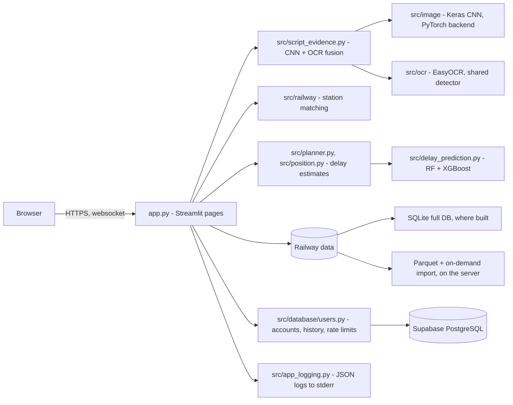

# RailScan architecture

A modular monolith: one Streamlit process holds the UI and calls plain Python modules in `src/`.
The only external service is the PostgreSQL database for accounts.

## Layers
| Layer | Choice | Alternative considered |
|---|---|---|
| UI and app | Streamlit | A Flask/FastAPI back end with a JS front end: more work and more moving parts for one developer |
| Script model | Keras MobileNetV2 on PyTorch | TensorFlow runtime: about 250 MB more memory and a 546 MB install (decision 0003) |
| OCR | EasyOCR with one shared text detector | Tesseract: not compared in this project; EasyOCR covers all four scripts with pip-installable models |
| Railway data on the server | Parquet, one train on demand | Building the full SQLite database at start: 4–5 min of full CPU (decision 0004) |
| Accounts | Supabase PostgreSQL | SQLite on the host: lost on every restart |
| Logs | JSON to stderr, redacted | A log service: none needed at this size |

## Background work
There is no job queue. One background thread per server process loads the scanner models after the first
page view. Everything else runs within the request, and the slow parts are cached (`st.cache_data` and
`st.cache_resource`, global data only, never per-user data).

## Folders
`app.py` (pages) · `src/` (logic) · `scripts/` (data pipeline, training, evaluation, backups) · `tests/` ·
`models/` · `data/` · `reports/` (measured results) · `docs/` (this, decisions, runbooks).

## Riskiest decisions
1. **Own password handling instead of an auth provider** (0005). It is tested, but there is no email
   verification or password reset.
2. **A free, shared host.** CPU throttling and sleeping are outside our control (0002).
3. **Long scans inside the request.** Acceptable for a few users at a time; at higher traffic scans would
   need a queue or a bigger host.
